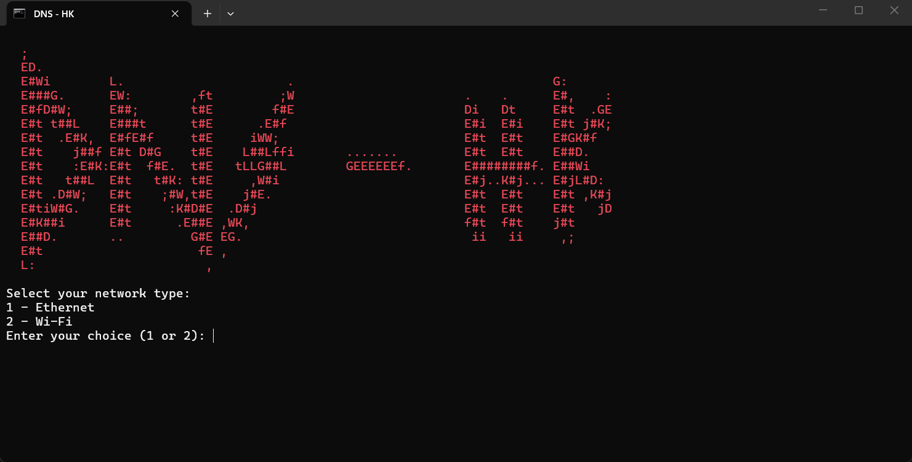

<h1 align="center">DNS Tool</h1>

<b>Switch the Windows DNS servers with a small menu</b>

  
  
  
  

---

## Overview
A Windows batch tool with an ASCII-art menu. Pick Ethernet or Wi-Fi, then apply one of three preset DNS server pairs or go back to automatic (DHCP) DNS. It uses 
etsh interface ip.

## Features
- Choose the adapter: Ethernet or Wi-Fi
- Three preset primary/secondary DNS pairs
- Reset to DHCP (automatic DNS)
- Back and exit options

## Screenshots

## Download and install
### Option A - Ready-to-run download (recommended)
1. Open the **[Releases page](https://github.com/alisadhk/dns-tool/releases/latest)**.
2. Download the file(s) listed under **Assets**:

| File | Size |
|---|---|
| `DNS-Tool-archive.rar` | 0 MB |

3. Run it. 

### Option B - Run the script
Download the script from this repository and run it as described in **How to use**.

## How to use
1. Right-click dns.bat and choose **Run as administrator**.
2. Choose **1** for Ethernet or **2** for Wi-Fi.
3. Choose **1**, **2** or **3** to apply a DNS preset, **4** to reset to DHCP, **5** to go back or **6** to exit.
4. Verify with ipconfig /all.

## Configuration and privacy
- The preset addresses are public resolver IPs; edit them in dns.bat (look for 
etsh interface ip set dns).

## Notes
- Administrator rights are required to change adapter settings.

---

Maintained by <a href="https://github.com/alisadhk">@alisadhk</a> - last update 2025-06-28
